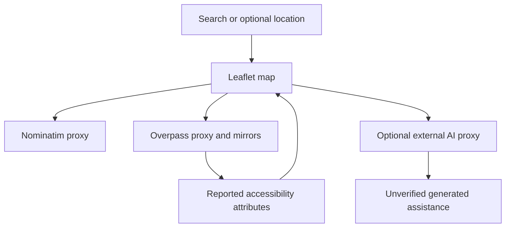

# HandiMonde — Carte des lieux accessibles · Studio Niko Design

**Accessibility information explorer · OpenStreetMap · Leaflet · Optional AI assistance**

[](LICENSE) · [Sécurité](SECURITY.md) · [English overview](#english-overview)

## Architecture



| Source | Fonction constatée |
| --- | --- |
| [api/osm.js](api/osm.js) | Requêtes Overpass, tentatives bornées sur plusieurs miroirs, distinction réponse vide / erreur |
| [api/geo.js](api/geo.js) | Géocodage Nominatim |
| [api/ai.js](api/ai.js) | Relais optionnel vers Mistral, Groq, Cerebras ou Gemini avec clé fournie par l'utilisateur |
| [vercel.json](vercel.json) | Routes et configuration d'hébergement |

Une information d'accessibilité issue d'OSM n'est pas une inspection du lieu. L'absence de tag ne signifie ni « accessible » ni « inaccessible ». Le relais IA transmet les messages et utilise la clé reçue pour le fournisseur sélectionné. La présence de ce connecteur ne prouve pas la disponibilité des modèles ni la qualité des conseils.

> **Projet signature · 06/06 · CARTOGRAPHIE** — [Étude de projet : problème, choix techniques et limites](https://github.com/Nikoju1977/Nikoju1977/blob/main/SHOWCASE.md) · [Portfolio Studio Niko Design](https://github.com/Nikoju1977).


**Catégorie : accessibilité & cartographie** · Studio Niko Design

Application web de consultation de lieux et d'équipements accessibles, basée sur les informations disponibles dans **OpenStreetMap**. Son but est de faciliter la recherche d'informations pratiques sur l'accessibilité, notamment pour les personnes à mobilité réduite.

## Fonctionnement

- Interface web en français (`index.html`, `app.html`).
- Carte web construite avec **Leaflet** et des données **OpenStreetMap**.
- Recherche et informations d'accessibilité d'après les données fournies par les sources.
- Fonctions serveur regroupées dans `api/` pour interroger les services externes.

Les informations cartographiques participatives peuvent être **absentes, datées ou incorrectes**. Il faut vérifier sur place ou auprès de l'établissement avant un déplacement important.

## Démarrage local

Pour explorer l'interface statique :

```bash
python3 -m http.server 8000
```

Puis ouvrir http://localhost:8000/. **Attention :** le simple serveur Python ne fournit pas les fonctions `/api` ; certaines fonctionnalités réseau demandent un environnement compatible avec la configuration Vercel.

## Déploiement

`vercel.json` définit les routes suivantes :

| Route publique | Fonction |
| --- | --- |
| `/places` | `/api/osm` |
| `/assist` | `/api/ai` |
| `/find` | `/api/geo` |

Consulter les variables d'environnement et la configuration des services utilisés dans les fonctions serveur avant déploiement. **Ne jamais committer de clés d'API.**

## Confidentialité et accessibilité

- La géolocalisation du navigateur, lorsqu'elle est sollicitée, nécessite une autorisation de l'utilisateur.
- Les recherches et coordonnées transmises à un service externe peuvent être traitées selon la politique de ce service.
- Le dépôt utilise des typographies adaptées à la lisibilité et des styles dédiés ; cela **ne constitue pas** une certification d'accessibilité numérique.
- Les données OpenStreetMap sont soumises à leurs conditions de réutilisation (ODbL) et aux obligations d'attribution applicables.

## Fichiers principaux

```text
index.html   Interface de consultation
app.html     Interface alternative
api/         Fonctions serveur (ai, geo, osm)
test.html    Page de test / vérification manuelle
vercel.json  Routage et en-têtes HTTP
```

**Statut :** application en développement ; aucune conformité WCAG/RGAA n'est revendiquée par cette documentation.

[Retour au catalogue Studio Niko Design](https://github.com/Nikoju1977).


## Qualification proposée

Utiliser des réponses OSM synthétiques pour vérifier les cas accessible, limité, inconnu, résultat vide, fournisseur indisponible et erreur de géocodage. Vérifier séparément l'usage clavier, la lisibilité, le lecteur d'écran et les parcours mobiles. Auditer la minimisation des coordonnées et requêtes, le cache des réponses et les contrôles de consommation des relais publics ; CORS ne remplace ni une authentification ni une limitation de débit. Ne pas utiliser de clé réelle ou de localisation privée pour ces essais.

Aucune conformité WCAG/RGAA, garantie d'accessibilité des lieux, vérification d'API ou validation de production n'a été établie par cette révision. Les données OSM conservent leurs obligations ODbL et d'attribution.

## English overview

HandiMonde displays reported accessibility information using Leaflet and OpenStreetMap. Server-side adapters handle Overpass queries, Nominatim geocoding and optional user-key AI assistance. Missing tags and unavailable providers must not be interpreted as verified accessibility. Confirm conditions with the venue before travel. No new accessibility audit, live API test or deployment verification was performed.

[Licence existante](LICENSE) : droits réservés sur le code selon la notice ; données et composants tiers soumis à leurs propres licences.
